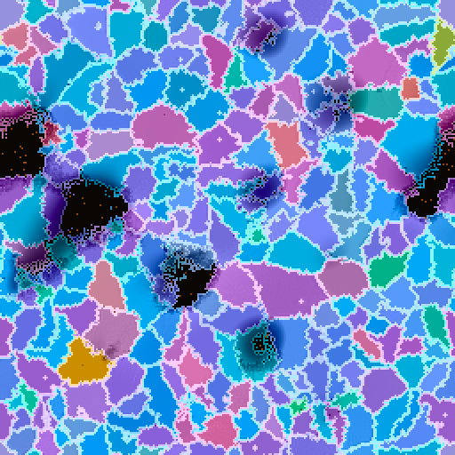

# Ribosome Soup

An artificial-life system where organisms grow from short mutable code strings, translated by a shared neural "ribosome". See [`initial_spec.md`](initial_spec.md) for the design and [`docs/m0_literature.md`](docs/m0_literature.md) for prior work.

## Quick start

```bash
pip install -r requirements.txt          # for CUDA, install torch from pytorch.org first
python -m pytest -q
python -m soup.run --config config/tier_s.yaml --ticks 2000 --snapshot out.png
python -m soup.run --config config/tier_s.yaml --bench
```

Useful flags: `--log metrics.jsonl` (per-epoch metrics), `--snapshot-every 100` (image sequence), `--device cpu|cuda`, `--seed N`.

## Layout

```
soup/
  config.py    defaults + YAML presets (config/tier_{s,m,l}.yaml)
  genome.py    token strings, effective length, spore-time mutation
  ribosome.py  frozen seeded transformer: genome -> dW, traits, embedding
  cellnet.py   cell-net weight layout, hand-set base net, batched per-cell forward
  fields.py    drifting light / heat fields on the torus
  world.py     grid, slots, tick loop (perceive, act, energy, death), epoch
  metrics.py   population/diversity/compression metrics, phenotype smoothness
  run.py       headless runner + benchmark
render/
  snapshot.py  PNG renderer (OKLCH lineage colour, membranes, heat speckle)
```

## Status

- **M0 literature check:** done.
- **M1 Tier S skeleton:** done. The world, the per-cell nets translated from genomes, the light and heat fields, and the benchmark all work. Grow, spore, attack and rest are implemented, along with slot allocation and freeing (part of M2), but **not yet calibrated**.
- **Next (M2):** calibrate energy so the grid doesn't saturate, run the viability scan, and tune `alpha` using the phenotype-smoothness metric.
- **Then (M3):** heat damage and HGT. These are marked `TODO(M3)` in `World.epoch`.

First measurements (cloud CPU, 4 threads; not representative of the RTX 3060):

| Measure | Value |
|---|---|
| Tier S, ~63k live cells | 6.4 ticks/s |
| Distinct genomes per 16×16 tile | ~4.6 (good for the M6 tiled kernel) |
| Phenotype smoothness, α = 0.5 | 4.2% median weight change per single-token mutant (spec target is 5–15%, so α can go up a little) |


