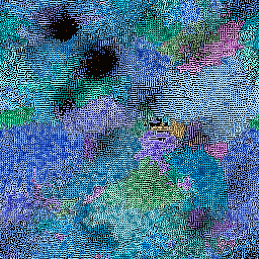

# M2 — Calibration notes

*Cloud CPU runs, Tier S config. Sweeps at 128×128 (64 founders, 1024 ticks); viability on a 512×512 lattice. Reproduce with `experiments/sweep.py` and `experiments/viability.py`.*

## 1. Energy: stop the grid saturating

With M1 defaults (`crowding 0.5`), the grid filled to ~98% and froze. There was almost no turnover, so spores never found space.

| crowding | photo | occupancy | organisms | mean energy | spores/tick | turnover (deaths/cell/tick) |
|---|---|---|---|---|---|---|
| 0.5 | 0.08 | 0.89 | 63 | 0.82 | 0.01 | 0.0007 |
| 0.5 | 0.12 | 0.98 | 76 | 0.93 | 0.002 | 0.0002 |
| 0.9 | 0.08 | 0.63 | 80 | 0.28 | 0.18 | 0.0056 |
| **0.9** | **0.12** | **0.77** | **117** | **0.33** | **0.35** | **0.0057** |
| 1.0 | 0.12 | 0.72 | 120 | 0.33 | 0.39 | 0.0073 |

At high crowding, cells buried inside a body earn almost nothing, so interiors thin out and space keeps reopening. **Chosen: `crowding 0.9`, `photo 0.12`.**

Mean energy then settles at about 0.3, below the old spore threshold range (0.3–0.95), so spores were still rare:

| spore_min | spore_energy | organisms | spores/tick | mean lineage depth |
|---|---|---|---|---|
| 0.1 | 0.12 | 516 | 6.2 | 1.21 |
| **0.1** | **0.2** | **691** | **5.5** | **1.44** |
| 0.2 | 0.12 | 178 | 1.3 | 0.79 |
| 0.2 | 0.2 | 243 | 1.3 | 0.99 |

(`spore_span 0.4` throughout.) **Chosen: `spore_min 0.1`, `spore_span 0.4`, `spore_energy 0.2`.**

> **Correction (found in M3):** a bug in `World.seed_founders` meant founders started with **zero energy and untranslated (all-zero) weights** until the first epoch (tick 32). All M2 numbers below were measured with this bug. After the fix I re-ran the α scan (heat/HGT off for heritability):
>
> | α | viable | smoothness | genome r | position r |
> |---|---|---|---|---|
> | 2 | 0.86 | 0.099 | 0.07 | 0.96 |
> | 4 | 0.78 | 0.112 | 0.27 | 0.63 |
> | **6** | **0.59** | **0.116** | **0.57** | **0.20** |
> | 8 | 0.46 | 0.117 | 0.62 | 0.05 |
>
> The conclusion holds (and is stronger): α = 6 is the right default.

## 2. α: does the genome actually matter?

The viability scan places 256 random-genome founders on a lattice (spacing 32) and runs 128 ticks. A genome is *viable* if its lineage has ≥ 16 cells at the end.

| α | viable | extinct | median size | p90 size | smoothness |
|---|---|---|---|---|---|
| 0.5 | 0.86 | 0.02 | 140 | 528 | 0.043 |
| 1 | 0.84 | 0.02 | 141 | 513 | 0.072 |
| 2 | 0.84 | 0.02 | 124 | 418 | 0.099 |
| 4 | 0.75 | 0.02 | 56 | 244 | 0.112 |
| **6** | **0.54** | **0.02** | **18** | **149** | **0.116** |
| 8 | 0.39 | 0.02 | 8 | 111 | 0.117 |
| 12 | 0.26 | 0.02 | 2 | 60 | 0.118 |

High viability at low α looked good, but it was misleading. A **heritability check** places the same 256 genomes twice in the same world, at shuffled lattice positions. It then correlates log colony size by genome (the genome effect) and by position (the light/environment effect):

| α | genome r | position r |
|---|---|---|
| 0.5 | 0.05 | – |
| 2 | 0.06 | – |
| 4 | 0.27 | 0.61 |
| **6** | **0.48** | **0.21** |
| 8 | 0.51 | 0.13 |

At the spec's α = 0.5 the base net does nearly all the work, and colony size is essentially independent of the genome. Selection would have nothing to act on. **Chosen: α = 6.** The genome then explains about twice as much as position, about half of random strings are viable, and phenotype smoothness is 11.6%, inside the spec's 5–15% target.

Phenotype smoothness saturates near 12% as α grows: a single-token change moves ΔW by about 12% of itself. So the landscape stays smooth enough even at large α.

Possible next step: add genome heritability as a standard metric (`experiments/`), since it caught a problem that viability and smoothness both missed.

## 3. Long run with calibrated defaults

256×256, 256 random founders (genome length 32), 4096 ticks, all defaults above. Heat damage and HGT are not implemented yet (M3); token cost is on.

| tick | occupancy | organisms | lineages | mean depth | distinct genomes | mean len | zlib ratio |
|---|---|---|---|---|---|---|---|
| 512 | 0.66 | 1980 | 206 | 2.5 | 945 | 31.6 | 0.112 |
| 1024 | 0.71 | 1883 | 169 | 3.3 | 891 | 31.2 | 0.111 |
| 2048 | 0.72 | 1268 | 116 | 3.4 | 637 | 30.5 | 0.105 |
| 3072 | 0.72 | 934 | 64 | 4.4 | 422 | 29.1 | 0.093 |
| 4096 | 0.72 | 987 | 51 | 6.1 | 387 | 27.8 | 0.078 |

What this shows:
- **Selection is working.** Founding lineages fall from 256 to 51, while the number of organisms settles near 1,000. That means coexistence, not a monoculture (yet).
- **Token cost is biting.** Mean effective length falls steadily (32 → 27.8), and the genome pool becomes more compressible.
- **Generations accumulate.** Mean lineage depth rises to 6, with max depth around 20.
- Population is stable at about 72% occupancy and mean energy 0.52.

Open issues for M3/M4:
- **Attack churn is very high**: about 550 cells conquered per tick (≈1.2% of cells), more than starvation deaths. Bodies are ragged and fragmented, which makes the render noisy (`docs/m2_snapshot.png`). Consider a higher `attack_cost`, a lower `loot`, or attack only above an energy threshold.
- Traits barely moved over 4096 ticks (aggression 0.527 → 0.545, fidelity flat). That's expected without heat damage, which is the only thing fidelity is for.
- Genomes per 16×16 tile is about 7–12 in this regime (vs. ~4.6 in the saturated M1 regime). That's still fine for the tiled kernel.
- Cloud CPU speed: about 8 ticks/s at 47k cells.

