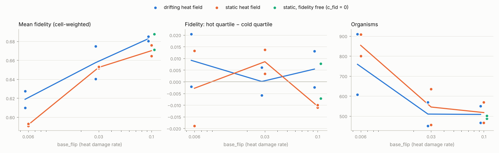

# M3 — The three features and the ablation grid

*Cloud CPU. Ablation: 128×128 grid, 64 random founders, 8192 ticks, 2 seeds per condition. Means over the last quarter of each run, averaged over seeds. Reproduce:*

```bash
python -m experiments.ablation --out runs/ablation --ticks 8192 --seeds 1,2 --procs 4
python -m experiments.plot_ablation runs/ablation docs/m3_ablation.png
```

## What was built

- **Heat on code** (`World.heat_damage`, every epoch). Each non-pad token flips with `p = base_flip · mean heat of the organism's cells · (1 − fidelity)`. A flip changes the token to any other symbol, pad included, so heat can also delete. Flipped organisms are re-translated at the end of the epoch.
- **Gene transfer** (`World.gene_transfer`). Up to 4096 random border pairs are sampled per epoch. With probability `p_hgt · permeability(recipient)`, a 2–8 token window that starts at a non-pad donor token is copied into the recipient at a random position. `has_hgt` marks the recipient and is inherited by its spores.
- **Token cost** already existed. When switched off, cells now pay a **flat** cost equal to a 32-token genome (see "Confound" below).
- **Direct-weight control** (`mode: direct`). Founders are translated from strings as usual, so both conditions start alike. After that, weights evolve directly:
  - **Spore mutation:** matched to string mode. 34% of spores change; when they do, the relative weight change is 0.144 and trait shifts have sd 0.133 in logit units. All three were measured at α = 6.
  - **Heat:** each "flip" is a Gaussian kick the size of a single-token change.
  - **Gene transfer:** the matching block of parameters is copied from the donor.
- **New metrics:** `hgt_frac`, `fid_heat_corr` (cell-level correlation of fidelity with local heat), `mean_org_size`, plus heat-flip and HGT counters.

## Calibration done along the way

| Issue | Fix |
|---|---|
| **Bug:** founders started with zero energy and all-zero weights until tick 32 | Fixed; M2 α results re-checked and still hold (see `m2_calibration.md`) |
| Heat flipped pads → mostly *inserted* code, mean length 32 → 45 | Heat only hits non-pad tokens |
| `p_hgt 0.05`: ~100% of genomes carried a splice within 1k ticks | `p_hgt 0.005` |
| Attack churn about 1.2% of cells per tick, ragged bodies | `attack_min 0.3` (attacker must have energy > 0.3), which halves conquests |
| `base_flip 2e-4` (spec) gives about 1 flip per 30k ticks | `6e-3`, about 1 flip per ~300 ticks for a typical organism |

### Confound found in the first ablation pass

With "cost off" meaning *zero* cost, every cost-off run saturated the grid: 99% occupancy, 10–24 giant organisms. The token cost is the largest energy sink, so removing it changed the whole energy economy, not just the length pressure. The four cost-off conditions were re-run with a flat cost. Everything below uses those runs.

## Results

| condition | organisms | Shannon | mean depth | mean len | hgt_frac | mean fidelity | corr(fid, heat) |
|---|---|---|---|---|---|---|---|
| baseline | 159 | 2.68 | 3.3 | 31.3 | 0 | 0.680 | −0.01 |
| +heat | 260 | 2.90 | 1.7 | 30.8 | 0 | 0.678 | −0.02 |
| +cost | 369 | 3.03 | 5.2 | 23.0 | 0 | 0.652 | 0.02 |
| +hgt | 177 | 3.01 | 2.2 | **56.0** | 1.0 | 0.651 | −0.02 |
| heat+cost | 221 | 2.85 | 5.7 | 26.5 | 0 | 0.678 | 0.00 |
| heat+hgt | 361 | 3.40 | 2.2 | **54.6** | 1.0 | 0.641 | 0.02 |
| cost+hgt | **844** | **5.06** | 13.8 | 25.8 | 0.97 | 0.587 | 0.00 |
| **full** | **759** | **4.87** | **27.1** | 26.2 | 1.0 | 0.619 | 0.03 |
| **control** (direct weights, all features) | 659 | 3.92 | 3.7 | 32 (fixed) | 1.0 | 0.644 | 0.01 |

Per seed (seed 1 / seed 2), to show how robust each result is:

| condition | organisms | Shannon | mean depth |
|---|---|---|---|
| cost+hgt | 896 / 793 | 5.14 / 4.98 | 14.4 / 13.2 |
| full | 607 / 910 | 4.71 / 5.03 | 10.1 / 44.1 |
| control | 377 / 942 | 3.55 / 4.28 | 2.8 / 4.6 |
| everything else | 108–498 | 2.4–3.6 | 1.4–8.7 |


## What it says (2 seeds — read as leads, not conclusions)

1. **Gene transfer + token cost together are the standout.**
   - Only the two conditions with both (`cost+hgt` and `full`) hold about 800 organisms and Shannon ≈ 5, in both seeds.
   - Every other condition sits at Shannon 2.4–3.6.
   - Neither feature does this alone. HGT without cost bloats genomes to ~55 tokens and gives little diversity. Cost without HGT shortens genomes (23 tokens) with modest diversity.
   - This interaction was not predicted by the spec and is the most interesting thing so far.
2. **Token cost works as designed.** Genomes shrink (31 → 23–26 tokens) and lineages go deeper. Without cost, gene transfer only ever adds material.
3. **Heat on code shows no adaptive signature yet.** Fidelity does not track local heat in any condition (|r| < 0.1, fluctuating sign), and mean fidelity does not rise. Possible reasons:
   - damage is still too rare to matter at this timescale;
   - fidelity's continuous energy cost outweighs its benefit;
   - the heat field drifts faster than lineages can adapt.

   **Next step:** a heat-strength sweep, plus a static heat field.
4. **String + ribosome vs. direct weights (the spec's key question).**
   - Full beats control on diversity in both seeds (Shannon 4.71/5.03 vs 3.55/4.28).
   - Lineages run far deeper in string mode (10–44 vs 3–5 generations).
   - Organism counts overlap between seeds.
   - The depth gap is large and not yet explained. Before claiming it, check whether control spores simply die younger (lifetime and spore-survival metrics).

## Caveats

- Two seeds at 128×128 is small. Seed-to-seed spread is large for some conditions (full's depth 10 vs 44).
- In control, `mean_len` is fixed by construction and `zlib_ratio` is meaningless (genomes are not used after founding).
- `hgt_frac` is an inherited flag, so it saturates even at low transfer rates. Measuring the fraction of *tokens* that came from splices would say more.
- Cloud CPU speed limited the run length. A 3060 should make 4–8 seeds at 256×256 cheap.

---

## Follow-up: why doesn't fidelity adapt to heat?

### Heat sweep

7 conditions × 2 seeds, 8192 ticks, 128×128, all features on (`experiments/heat_sweep.py`). It crosses heat strength with a drifting vs. static heat field, plus free fidelity at the strongest heat.

| condition | flips / organism / epoch | mean fidelity | hot − cold fidelity | repeat_frac | organisms |
|---|---|---|---|---|---|
| flip 0.006, drift | 0.034 | 0.619 | +0.009 (+0.02 / −0.002) | 0.040 | 759 |
| flip 0.006, static | 0.037 | 0.592 | −0.003 (−0.019 / +0.013) | 0.030 | 854 |
| flip 0.03, drift | 0.165 | 0.657 | +0.000 (+0.006 / −0.006) | 0.011 | 510 |
| flip 0.03, static | 0.176 | 0.652 | +0.009 (+0.014 / +0.003) | 0.021 | 545 |
| flip 0.1, drift | 0.46 | 0.683 | +0.005 (−0.002 / +0.013) | 0.005 | 508 |
| flip 0.1, static | 0.47 | 0.670 | −0.011 (−0.010 / −0.011) | 0.009 | 517 |
| flip 0.1, static, c_fid = 0 | 0.44 | 0.679 | +0.000 (−0.007 / +0.008) | 0.003 | 494 |

(Initial mean fidelity ≈ 0.65. Per-seed values in brackets.)



- **Global response: yes.** Mean fidelity is selected *down* when damage is rare (0.59–0.62, since it costs energy and buys little) and *up* when damage is common (0.67–0.68). Both seeds agree.
- **Local response: no.** Hot-region organisms never carry more fidelity than cold-region ones (|Δ| ≤ 0.02, sign flips between seeds). This holds whether or not the heat field drifts, so drift is not the cause.
- **Not cost-limited.** Making fidelity free changes nothing at strong heat (0.68).
- **Redundancy goes the other way.** Repeated 4-mers get *rarer* as heat rises (4% → 0.3–1%): flips break repeats faster than duplication makes them. Evolution is not using duplication as a repair route here.

### Is heat damage harmful at all?

`experiments/damage_cost.py`: evolve 4096 ticks, take the 128 most abundant genomes, apply k heat-style flips, and grow parents and mutants from single founders in isolation (2 placements each). Paired comparison:

| genomes | k flips | Δ log colony size vs parent | fraction worse |
|---|---|---|---|
| evolved | 1 | −0.07 ± 0.06 | 0.55 |
| evolved | 3 | −0.07 ± 0.10 | 0.51 |
| random | 1 | +0.07 ± 0.07 | 0.45 |
| random | 3 | −0.29 ± 0.09 | 0.58 |

**Heat damage is close to neutral for evolved genomes.** One flip costs about 7% of colony size, not distinguishable from zero, and about half of mutants do better than their parents. With damage this cheap, selection on fidelity is weak. That explains the small global response and why no local signal shows above the noise.

Caveat: isolated growth is not competitive fitness. Evolved genomes barely out-grow random ones in this assay (3.50 vs 3.42 log size), so it may understate what damage costs in a crowded world. A competition assay (mutant vs. parent placed side by side) would settle it.

### What would make heat matter (options, not done)

1. **Make the code more fragile.** The smooth genotype→phenotype map (about 12% weight change per token) is good for evolvability but makes damage cheap. Options: a sharper ribosome, or "essential" token positions.
2. **Make fidelity a stronger lever.** Damage currently scales with `(1 − fidelity)` over a trait range of about 0.5–0.8, only about 2.5× variation. Try `(1 − fidelity)²` or a wider trait range.
3. **Reduce mixing between heat zones.** A bigger grid relative to heat patches, or heat patches that act as barriers, would give local lineages time to adapt.
4. **Spec open question 1:** let heat also perturb cell state or energy directly, so hot zones are harsh regardless of the genome.
